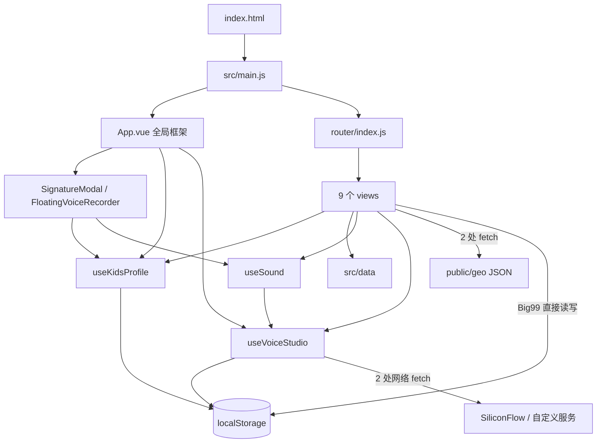

# 01 架构设计评估

测绘日期：2026-11-06；基于当前工作区（含未提交改动及未跟踪的 `src/views/GeoProvinceView.vue`），沿用 [阶段 0 的排除规则和行数口径](00-项目测绘.md)。结论为静态检查；未经运行验证的行为标记【待确认】。工作量为单人相对量级：S 半天至 2 天，M 3–5 天，L 1–2 周，XL 超过 2 周；含验证，依实际测试基础调整。

## 现状与主要边界

入口与依赖见 `src/main.js:1-8`、`src/App.vue:74-99`、`src/router/index.js:10-70`；共享状态和网络调用见 `src/composables/useKidsProfile.js:11-23,39-50`、`src/composables/useVoiceStudio.js:812-879`、`src/views/ChinaGeoView.vue:507-517`、`src/views/GeoProvinceView.vue:535-546`。图中未展示 data URL 的本地 `fetch`（`src/composables/useVoiceStudio.js:487`）。

| 观察 | 证据与影响 | 可执行建议、收益、工作量 |
|---|---|---|
| 地图数据访问落在页面中 | 两个地图页面各自直接 `fetch` 并自行处理异常；`src/views/ChinaGeoView.vue:507-517`、`src/views/GeoProvinceView.vue:535-546`。这不是预先约定的违规，但使错误状态和请求策略分散。 | 在 `src/` 新增地图数据访问模块，抽取两处读取并统一 HTTP 状态、解析与错误返回；页面保留展示状态。收益：减少两处策略漂移；M。 |
| 档案有两套访问路径 | `useKidsProfile` 负责读写及共享 ref（`src/composables/useKidsProfile.js:11-23,39-48`），`Big99View.vue:238-258,321-345` 又直接操作相同业务存储；页面卸载时显式刷新（`src/views/Big99View.vue:2447-2449`）。同步时序与遗漏风险需实际验证。 | 将乘法、档案、历史的读写收敛到 `src/composables/useKidsProfile.js` 或专用存储模块，保留现有 key 和数据迁移规则；以跨页面刷新场景验收。收益：减少双份状态同步；L。 |
| 大九九混用 Vue 与命令式 DOM | 生命周期内部持有逻辑（`src/views/Big99View.vue:234-262`），直接 DOM 查询（`:456,533`）并暴露 window 方法（`:2420-2425`）。大文件中交互边界难以独立验证。 | 先以乘法网格及弹窗为切口，提取 Vue 组件并通过事件驱动；逐步移除对应 window 方法，保留现有行为。收益：让局部交互可独立维护；L。 |
| 共用模块职责宽 | `useKidsProfile` 返回档案、5 科进度、弹窗、提示和统计（`src/composables/useKidsProfile.js:303-335`），积分公式跨学科（`:267-282`）；9 个页面均直接使用它（`rg -n 'useKidsProfile' src/views`）。 | 以持久化契约不变为前提，先分离积分计算和各学科写入接口，保留兼容入口；收益：改一门课程时缩小影响面；M。 |

## 模块耦合与调用链抽样

`node_modules/.bin` 中没有 `madge` 或 `dpdm`；未安装新工具。以下只检查 3 条链，**不能证明全仓库无循环依赖**。基于实际 import 的抽样，未在这些链中发现返回上游的静态引用；动态行为及全量图【待确认】，需要在不改变仓库状态的环境运行依赖图工具验证。

1. 地理：`src/router/index.js:55-65` → `src/views/ChinaGeoView.vue:521-535` → `useKidsProfile.recordGeoProgress`（`src/composables/useKidsProfile.js:211-225`）→ `safeSaveJSON`（`:20-23`）；进入省份页后单独读取地图（`src/views/GeoProvinceView.vue:535-546`）。
2. 诗词：`src/router/index.js:48-52` → `src/views/PoetryDetailView.vue:492-511` → `src/data/index.js:1-16` 或 `recordPoetryProgress`（`src/composables/useKidsProfile.js:124-146`）→ 本地存储（`:20-23`）。
3. 语音：`src/components/FloatingVoiceRecorder.vue:119-123,145-147` → `src/composables/useSound.js:19-30,276-289` → `src/composables/useVoiceStudio.js:812-853` → 外部合成服务；另一条上传请求见 `:856-881`。

`src/data/index.js:1-16` 依赖其他 data 文件；本次抽样未发现 data 反向 import 页面或组件。全仓库跨层依赖和循环依赖仍需依赖图工具确认。

## 路由、状态和数据层

- 路由集中在 `src/router/index.js:10-70`：9 个页面路由、2 个参数路由、2 组 alias，以及兜底重定向；首页静态导入，其余 8 个路由使用动态 import（`:2,18-65`）。9 个 `src/views/*.vue` 文件均出现在路由表中，因此按文件名静态对照没有孤儿页面；无自动化访问验证，运行时死路由【待确认】。路由表和全文件 `rg` 未见路由守卫，权限需求本身【待确认】。非法诗词 id 会回退到第一首（`src/data/index.js:15-16`），是否符合产品预期【待确认】。
- 共享状态未使用独立 store 库：`useKidsProfile` 包含档案、乘法、诗词、拼音、英语、地理进度及弹窗/提示，`useSound` 管声音状态，`useVoiceStudio` 管声音设置（`src/composables/useKidsProfile.js:39-50`、`src/composables/useSound.js:4-6`、`src/composables/useVoiceStudio.js:505-517`）。`showProfileModal` 和 `globalToastMsg` 是跨组件 UI 状态；没有发现将表单临时值放入该共享档案的证据，不能断言不存在其他全局滥用。`Big99View.vue:241-258,321-345` 直接读写浏览器存储，不是直接修改暴露的 store ref。
- `rg -n 'fetch\\(|axios|XMLHttpRequest' src` 共找到 **5 个 `fetch` 调用点**：两个页面加载地图 JSON、一个读取 data URL、两个声音服务请求；未找到 axios 或 XMLHttpRequest 调用。没有统一 API 客户端（5 处均为直接调用），地图请求只捕获异常、不检查 `res.ok`（两个地图文件上述行号）；声音合成检查 `res.ok` 但捕获错误后返回 null（`src/composables/useVoiceStudio.js:826-853`），上传将响应错误转为异常（`:872-881`）。本次检索未找到请求拦截器、重试或 `AbortController`；缺少不代表所有请求都需要这些机制。
- `src/composables/useVoiceStudio.js:820,872` 包含两个固定服务地址；`:817-820` 同时支持自定义合成地址。全仓为 JavaScript/Vue，无 TS 响应类型；接口运行时校验是否充分【待确认】。建议在地图读取模块及声音服务模块明确输入、响应和错误契约；对需要的调用按需添加取消/超时，避免盲目重试音频上传。收益：错误可见且行为一致；M。

## 组件、复用与样式

- **12/12 个 Vue 文件超过 300 行**：`App.vue` 506；`components/FloatingVoiceRecorder.vue` 515、`components/SignatureModal.vue` 555；`views/Big99View.vue` 4,014、`PinyinView.vue` 2,732、`VoiceStudioView.vue` 2,510、`EnglishView.vue` 2,227、`PoetryDetailView.vue` 1,782、`GeoProvinceView.vue` 1,414、`HomeView.vue` 1,294、`ChinaGeoView.vue` 1,210、`PoetryListView.vue` 807。行数包含模板、脚本、样式与注释，不等于圈复杂度；统计命令和口径见阶段 0。
- `rg -n 'defineProps|defineEmits|props:' src` 未命中，按这三种显式声明方式统计的 props 分布为 **12 个 Vue 文件均无命中**；不排除其他声明形式或 DOM 属性，不能将其等同于完整组件 API 分析。`src/App.vue:79-83` 实际复用 2 个全局组件。页面内部可拆分的模板块需要结合交互验证，props drilling 深度【待确认】：当前没有足够的组件层次数据证明其存在。
- 疑似重复对：两地图页面各有 `createProjector` 和 `geometryToSvgPath`（`src/views/ChinaGeoView.vue:375,398`；`src/views/GeoProvinceView.vue:432,455`），默认 padding 分别为 28、36，是否语义完全等价【待确认】；`Big99View` 和 `useKidsProfile` 各有档案/历史的 localStorage 读写（`src/views/Big99View.vue:321-345`；`src/composables/useKidsProfile.js:11-23,84-95`），不是重复组件。建议先比较输入、投影差异和现有地图表现，再抽取可参数化的几何函数；收益：修复投影时减少双处改动；M。
- 按 Vue `<style>` 区块及 `src/assets/main.css` 统计：13 个样式块中 **11 scoped、2 全局**（后者为全局 CSS 和 `src/views/Big99View.vue:2453`）。大九九全局块包含 `:root`（`:2455`），可能影响其他页面；具体碰撞【待确认】，需浏览器跨路由样式检查。建议为大九九规则加根容器限定并保留需全局生效的变量，逐页视觉回归；收益：降低样式互相影响；M。
- 样式文本正则统计：`!important` **5 次**、十六进制颜色字面量 **1,633 次**、`px` 数值字面量 **2,994 次**（均为出现次数，含重复、注释及可能非颜色的匹配；不将所有 px 判为魔法数字）。例如 `src/views/GeoProvinceView.vue` 3 个 `!important`，`src/views/Big99View.vue` 2 个。建议在 `src/assets/main.css` 定义经设计确认的高频颜色和间距变量，先迁移新增/高频样式；收益：降低全局主题调整成本；M，具体收益需盘点不同值后验证。

## 构建与环境

`vite.config.js:12-22` 使用一个 Vue 插件，配置 `@` 别名、输出目录；`src/router/index.js:18-65` 有路由级拆包，具体 chunk 体积及公共依赖分配【待确认】，需要在隔离输出目录构建分析。`vercel.json:2-9` 配置构建和 SPA rewrite；`src/router/index.js:5` 使用 `BASE_URL`。仓库未发现 `.env*` 配置；`useVoiceStudio.js:817-820` 的自定义 endpoint 来自运行时设置而非环境变量。未发现显式 chunk 大小预算、压缩或 CDN 策略（仅依据 `vite.config.js:12-22`），实际部署平台策略【待确认】。

建议先建立不覆盖现有 `dist/` 的隔离构建与 chunk 基线，再针对最大 chunk 制定预算；收益：改进能以实际体积衡量；S。此阶段未执行构建、测试或联网安装。

## 检索和限制

- `rg -n` 检索 import、请求、状态、路由、props、样式及定时器；人工读取上述关键位置。
- Python 仅从 Vue 的 `<style>` 与全局 CSS 提取文本，再用正则计数；不是 CSS AST、重复率或语义分析。
- 仅有三条调用链的人工抽样，未做全量依赖图、浏览器交互、权限业务规则及网络故障验证；不能据此给出全仓循环依赖数或死路由数。
